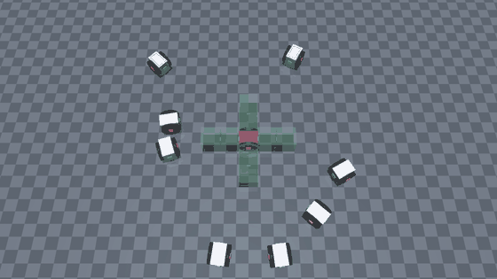
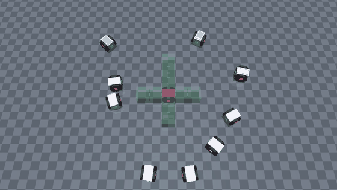

# modular-robot-self-assembly

**Parallel self-assembly of modular robots, reproduced in MuJoCo.**

Differential-drive modules scattered on the floor plan their own target slots, drive there in parallel batches, and dock into one robot. This is an independent re-implementation of the planning pipeline from

> C. Liu, Q. Lin, H. Kim, M. Yim. *SMORES-EP, a modular robot with parallel self-assembly.*
> Autonomous Robots 47, 211–228 (2023). [doi:10.1007/s10514-022-10078-1](https://doi.org/10.1007/s10514-022-10078-1)

| Paper Task 2 — nine modules | Ten modules |
|---|---|
|  |  |

Colours show each module's docking phase: navigate (blue) → adjust (yellow) → approach (orange) → docked (green). The root module is red; translucent boxes are the planned slots. GIFs play at 4–5× speed; full-speed videos are in [`media/`](media/).

## What is implemented

```
target configuration (a tree of modules and face-to-face connections)
   │  Definition 1 check ............. planner/unfold.py
   │  Algorithm 1: root module ....... planner/topology.py
   │  Eq. (2): unfold to planar slots . planner/unfold.py
   │  Eq. (3) + Hungarian assignment .. planner/assignment.py
   │  Algorithm 2: parallel batches ... planner/scheduler.py
   │  grid routing (A*) ............... planner/routing.py
   │  three-phase docking control ..... planner/controller.py
   ▼
MuJoCo execution ...................... sim_mujoco/
```

The planning steps are checked against the paper's own data: the root module, the assignment computed from Table 2's initial poses, and the batch order of Tasks 1 and 2 all match what the paper reports. Both the nine-module task and a ten-module variant assemble end to end, with docking residuals under 0.2 mm.

`planner/` never touches the MuJoCo API. Everything goes through three calls in `sim_mujoco/bridge.py` — `get_pose`, `set_wheel_velocity`, `activate_weld` — so the planner can be moved to another simulator by rewriting that one file.

## Quick start

Requires Python 3.12 or newer. Tested with MuJoCo 3.12 and 4.0.

```bash
python -m venv .venv && source .venv/bin/activate
pip install -r requirements.txt
```

```bash
python -m sim_mujoco.runner_full --headless             # paper Task 2: schedule, timing, residuals
python -m sim_mujoco.runner_full --headless --task ten  # ten modules
python -m sim_mujoco.experiments ablation               # the ablation discussed below
python -m tests.test_bridge && python -m tests.test_wrist
```

To watch it live, drop `--headless`. On macOS the viewer must be started with `mjpython` instead of `python`.

## Limitations

A reproduction that runs is not the same as a reproduction that is faithful. These are the places where this one departs from the paper or from reality, and what each departure costs.

**1. Docking is a weld, not a magnet.**
The real EP-Face is an electro-permanent magnet that pulls modules together over the last few millimetres. Here a module is snapped to the ideal pose and welded once it is within 12 mm and 12° of it. The contact phase the hardware has to survive is therefore skipped, and the sub-millimetre residuals above say more about the snap than about the controller.

**2. That simplification can silently delete the physics a design rule exists for.**
The paper docks modules onto the root in two batches, arguing that simultaneous pushes would shove the unanchored root away. Switching the rule off here makes assembly *faster* and the measured push on the root is zero in both cases — because modules are welded before they touch. Only when the acceptance zone is tightened to 2 mm, close to the hardware's 4 mm, does pushing appear, and then splitting roughly halves the peak force on the root (13 N against 25 N). Read at the default setting, the experiment would have "shown" the paper's rule to be useless. Neither tight-zone run completes, which points at the next limitation.

**3. The approach controller is open-loop with respect to contact.**
Modules drive in at constant speed along a straight line. With a tight acceptance zone they push the root several centimetres instead of settling against it. Hardware gets away with this because the magnet does the final alignment; a simulation without magnets needs the controller to do it.

**4. Routing is not multi-robot planning.**
Each module plans alone with A\* on the paper's 10 cm grid, treats every other module as a static obstacle, and replans every 1.5 s. Of the paper's three conflict strategies (Wait, Avoid, Push) only Wait exists. It works for ten modules with well-separated starts; it has no guarantee against deadlock and will not scale to crowded scenes.

**5. Only half of the connection types are supported.**
A module can dock with its front or rear face by driving forward. Docking with a wheel face needs a second "helping" module to lift and carry it (Sec 5.3.3), which is not implemented, so target configurations here are restricted to those that avoid it.

**6. The assembly stays flat.**
The paper's robots fold from the planar pattern into a 3D shape. TILT and PAN joints are modelled and tested, but welds attach module bodies rather than wrist links, so driving a joint after docking fights the weld. Folding is not possible until that is changed.

**7. Evidence is thin.**
Each task was run from one set of initial poses, in an ideal world: no sensing noise, no communication delay, no wheel slip model beyond Coulomb friction. Nothing here is a statistical result, and nothing has been tried on hardware.

**8. Many numbers are mine, not the paper's.**
Wheel geometry, friction, weld stiffness, actuator force limits and all controller gains except K = diag(2, 1) were chosen to make the simulation behave.

## Future work

Ordered by how much each would improve the fidelity of the conclusions, not by difficulty.

1. **Contact-aware approach.** Read contact forces during the approach phase and slow down on touch, so that docking succeeds with a hardware-sized acceptance zone. This is the prerequisite for any claim about pushing, ordering or robustness.
2. **A magnet model.** Replace snap-and-weld with a short-range attractive force and a latch condition, so the last millimetres are simulated rather than assumed.
3. **Statistics instead of single runs.** Batch headless runs over randomised initial poses and report success rate, time and root displacement with confidence intervals; rerun the ablation that way.
4. **Real multi-robot planning.** Add Avoid and Push, or replace per-module A\* with a prioritised or conflict-based planner, and measure where the current scheme starts to deadlock as module count grows.
5. **Helping modules.** Implement wheel-face docking so arbitrary tree configurations become reachable, including the paper's Task 1 mobile manipulator.
6. **Folding into 3D.** Re-attach welds to the wrist links, then add a folding controller and check the folded structure against the paper's demonstrations.
7. **Imperfect sensing and communication.** Inject pose noise and delay to find how much the docking controller tolerates before the schedule breaks.
8. **A second simulator.** Port `bridge.py` to Isaac Sim to test whether the planner layer is as engine-independent as intended.
9. **Learning-based docking.** Use the scripted three-phase controller as a baseline and train a policy for the final approach, where hand-tuned gains are weakest.

## Repository layout

```
planner/      engine-independent planning and control
sim_mujoco/   model generation, simulator bridge, docking state machine, runners, experiments
tests/        headless checks of the simulation interface and wrist joints
examples/     a minimal MuJoCo example
media/        demo videos, GIFs and a path figure
```

## Citation

If you use this code, please cite the original paper:

```bibtex
@article{liu2023smoresep,
  title   = {SMORES-EP, a modular robot with parallel self-assembly},
  author  = {Liu, Chao and Lin, Qian and Kim, Hyun and Yim, Mark},
  journal = {Autonomous Robots},
  volume  = {47},
  pages   = {211--228},
  year    = {2023},
  doi     = {10.1007/s10514-022-10078-1}
}
```

This repository is not affiliated with the authors of the paper.

## License

MIT
