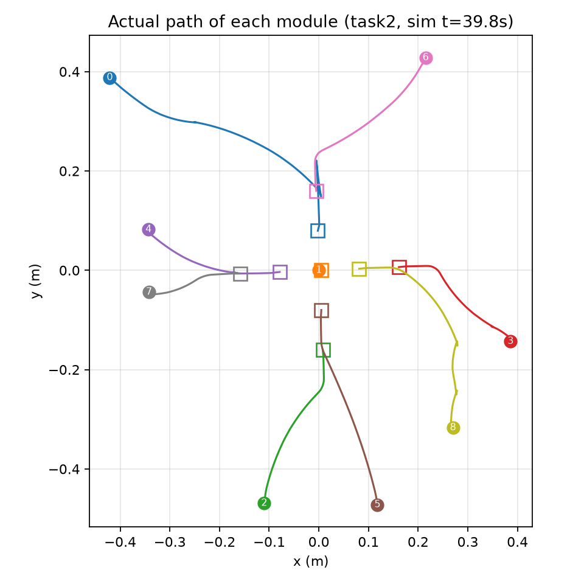

# modular-robot-self-assembly

**Parallel self-assembly of modular robots, reproduced in MuJoCo.**

Ten differential-drive modules scattered on the floor plan their own target slots, drive
there in parallel batches, and dock into one robot. This is an independent re-implementation
of the planning pipeline from

> C. Liu, Q. Lin, H. Kim, M. Yim. *SMORES-EP, a modular robot with parallel self-assembly.*
> Autonomous Robots 47, 211–228 (2023). [doi:10.1007/s10514-022-10078-1](https://doi.org/10.1007/s10514-022-10078-1)

checked step by step against the numbers published in the paper.

| Paper Task 2 — nine modules | Ten modules |
|---|---|
|  |  |

Colours show each module's docking phase: navigate (blue) → adjust (yellow) → approach (orange) → docked (green). The root module is red; translucent boxes are the planned slots. GIFs play at 4–5× speed; full-speed videos are in [`media/`](media/).

> 中文简介：在 MuJoCo 里复现 SMORES-EP 模块化机器人的并行自组装（Liu et al., *Autonomous Robots* 2023）。
> 实现了论文第 4–5 节的完整规划链：找根模块、平面展开、匈牙利任务分配、分层并行调度、三段式对接控制，
> 并用论文公布的原始数据逐项核对。九模块和十模块都能端到端装配完成。过程笔记见 [`docs/`](docs/)。

## What is reproduced, and how it was checked

Wherever the paper gives concrete numbers, the code is run on the paper's own data and compared.

| Paper | Code | Check | Result |
|---|---|---|---|
| Sec 4.1, Algorithm 1 — root module search | `planner/topology.py` | Task 1 and Task 2 configurations | root = module 1 in both, as in the paper |
| Sec 4.2, Definition 1 — physical realisability | `planner/unfold.py` | 2 valid configurations, 2 kinds of invalid ones | invalid ones rejected |
| Sec 5.1, Eq. (2) — unfolding to the plane | `planner/unfold.py` | layouts vs. Fig. 8g / 13f | same shapes |
| Sec 5.1, Eq. (3) + Kuhn–Munkres assignment | `planner/assignment.py` | initial poses from Table 2 | mapping `[1, 0, 8, 5, 4, 6, 3, 2, 7]` — identical to the paper in all nine positions |
| Sec 5.2, Algorithm 2 — parallel assembly sequence | `planner/scheduler.py` | execution order in Sec 6.1 / 6.2 | batch-by-batch identical for both tasks |
| Sec 5.3, Eqs. (4)–(6) — three-phase docking | `planner/controller.py`, `sim_mujoco/statemachine.py` | closed loop in simulation | converges; singularity guard added (see below) |
| Whole pipeline | `sim_mujoco/runner_full.py` | end-to-end, headless | 8/8 and 9/9 connections |

End-to-end results on this machine (MuJoCo 3.12, headless):

| Task | Modules | Batches | Simulated time | Max docking residual |
|---|---|---|---|---|
| Paper Task 2 (omnidirectional vehicle) | 9 | 3 | 39.8 s | 0.17 mm, 0.05° |
| Ten modules (Task 2 with one arm extended) | 10 | 4 | 53.8 s | 0.18 mm, 0.01° |

On Table 2's poses the optimal assignment travels 2.7023 m in total; a greedy assignment travels 2.7855 m (3.1 % more).

<p align="center"></p>

## An ablation: does splitting the root layer matter?

The paper docks modules onto the root in two batches (left/right faces first, then top/bottom), arguing that simultaneous pushes would shove the unanchored root away. `sim_mujoco/experiments.py ablation` switches that rule off and measures the push on the root.

| Acceptance zone | Root layer | Batches | Completed | Time (s) | Peak push on root (N) |
|---|---|---|---|---|---|
| 12 mm | split (paper) | 3 | yes | 40.9 | 0.00 |
| 12 mm | not split | 2 | yes | 26.1 | 0.00 |
| 2 mm | split (paper) | 3 | no | — | 13.4 |
| 2 mm | not split | 2 | no | — | 25.2 |

With the default 12 mm zone the rule appears useless, even harmful: modules are welded before they touch the root, so the pushing the rule exists to manage never happens. Tightened to 2 mm, close to the hardware's 4 mm, the pushing appears and splitting roughly halves the peak force — consistent with the paper's argument. Neither tight-zone run completes, because the constant-speed approach here is stiffer than a magnet pulling in the last millimetres. This is one initial condition, not a statistical result. Details: [`docs/trails-and-ablation.zh.md`](docs/trails-and-ablation.zh.md).

## Quick start

Requires Python 3.12 or newer.

```bash
python -m venv .venv && source .venv/bin/activate
pip install -r requirements.txt
```

```bash
python -m sim_mujoco.runner_full --headless            # paper Task 2, prints the schedule and residuals
python -m sim_mujoco.runner_full --headless --task ten # ten modules
python -m sim_mujoco.experiments ablation              # the table above
python -m sim_mujoco.experiments plot                  # path figure -> media/paths-task2.png
python -m sim_mujoco.record --task ten                 # off-screen video -> media/demo-ten.mp4
```

To watch it live, drop `--headless`. On macOS the viewer must be started with `mjpython` instead of `python`:

```bash
mjpython -m sim_mujoco.runner_full --task ten
```

Tests and self-checks (also run in CI):

```bash
python -m tests.test_bridge      # simulation interface: driving, docking, rigidity
python -m tests.test_wrist       # TILT / PAN wrist joints, no regression in docking accuracy
python -m planner.assignment     # each planner module re-checks itself against the paper's data
```

## How it works

```
target configuration (a tree of modules and face-to-face connections)
   │  Definition 1 check ............ planner/unfold.py
   │  Algorithm 1: root module ...... planner/topology.py
   │  Eq. (2): unfold to planar slots  planner/unfold.py
   │  Eq. (3) + Hungarian assignment . planner/assignment.py
   │  Algorithm 2: parallel batches .. planner/scheduler.py
   │  grid routing (A*) .............. planner/routing.py
   │  three-phase docking control .... planner/controller.py
   ▼
MuJoCo execution ..................... sim_mujoco/
```

`planner/` never touches the MuJoCo API. Everything goes through three calls in `sim_mujoco/bridge.py` — `get_pose`, `set_wheel_velocity`, `activate_weld` — so the planner can be moved to another simulator by rewriting that one file.

```
planner/      engine-independent planning and control
sim_mujoco/   model generation, simulator bridge, docking state machine, runners, experiments
tests/        headless checks of the simulation interface and wrist joints
examples/     a minimal MuJoCo example (one wheeled cart and a box)
docs/         working notes (Chinese): attribution, verification, pitfalls, wrist joints, ablation
media/        demo videos, GIFs and the path figure
```

## What comes from the paper and what does not

The graph model, root search, unfolding, assignment, parallel scheduling, the docking control law with its gain K = diag(2, 1), the 80 mm module and the 10 cm routing grid are the paper's. The following are mine, and are simplifications or additions rather than reproductions:

- **Docking is a weld constraint.** The real EP-Face is an electro-permanent magnet. Here a module is snapped to the ideal pose and welded once it is within 12 mm and 12° of it.
- **Routing is single-robot A\*** with the other modules as static obstacles, replanned every 1.5 s. The paper uses a multi-robot planner (Binder et al., 2019) with Wait / Avoid / Push; only Wait is implemented.
- **Navigation and approach controllers** are simple proportional laws; the paper does not give theirs.
- **A singularity guard** for Eq. (6) when the heading error approaches zero, which the paper does not discuss.
- **A closed-form relative pose for all 16 face pairings.** The paper gives one example and a figure.
- **Simulation parameters**: wheel size, friction, weld stiffness, actuator force limits, collision masks.

A line-by-line table is in [`docs/attribution.zh.md`](docs/attribution.zh.md).

## Limitations

- Connections that need a helping module (a module docking with its left or right wheel face, Sec 5.3.3) are not implemented; target configurations here avoid them.
- TILT and PAN wrist joints are modelled and tested, but folding the assembled planar structure into its 3D shape is not implemented. Welds attach module bodies, not wrist links, which would have to change first.
- Magnetic attraction is not simulated, so behaviour in the last few millimetres of docking differs from hardware.
- Results are from simulation only, with one set of initial poses per task.

Four simulation-specific problems that cost the most time — welds fighting contacts, unlimited actuator torque launching modules, snapping the wrong body, and driving straight into the assembly — are written up in [`docs/simulation-pitfalls.zh.md`](docs/simulation-pitfalls.zh.md).

## Citation

If you use this code, please cite the original paper:

```bibtex
@article{liu2023smoresep,
  title   = {SMORES-EP, a modular robot with parallel self-assembly},
  author  = {Liu, Chao and Lin, Qian and Kim, Hyun and Yim, Mark},
  journal = {Autonomous Robots},
  volume  = {47},
  pages   = {211--228},
  year    = {2023},
  doi     = {10.1007/s10514-022-10078-1}
}
```

This repository is not affiliated with the authors of the paper.

## License

MIT
